# Kubernetes Workload Distribution

A multi-node Kubernetes project demonstrating **container orchestration, workload distribution, resource monitoring, horizontal scaling, and node failure recovery** using Docker, Kind, and Kubernetes.

The project also includes a Flask-based monitoring dashboard that visualizes cluster health, Pod placement, CPU and memory utilization, and application health.

---

## Project Overview

This project deploys a containerized Flask application across a multi-node Kubernetes cluster and investigates how Kubernetes manages application workloads.

**Cluster configuration:**
- 1 Control Plane node
- 2 Worker nodes
- Multiple application replicas
- Kubernetes ClusterIP Service
- Metrics Server
- Flask monitoring dashboard

## Objectives

- Create a multi-node Kubernetes cluster using Kind.
- Deploy a containerized application using Kubernetes Deployment.
- Observe Pod scheduling across worker nodes.
- Monitor CPU and memory utilization.
- Test application availability through a Kubernetes Service.
- Simulate worker node failure and observe Pod rescheduling.
- Perform horizontal scaling from 6 to 8 replicas.
- Visualize cluster information using a custom monitoring dashboard.

## Technology Stack

| Technology | Purpose |
|---|---|
| Docker Desktop | Containerization |
| Kubernetes | Container orchestration |
| Kind | Local Kubernetes cluster |
| kubectl | Cluster management |
| Python | Application backend |
| Flask | Web application and APIs |
| HTML, CSS, JavaScript | Dashboard frontend |
| Chart.js | Dashboard charts |
| Metrics Server | Resource monitoring |
| RBAC | Kubernetes API access control |

## Architecture

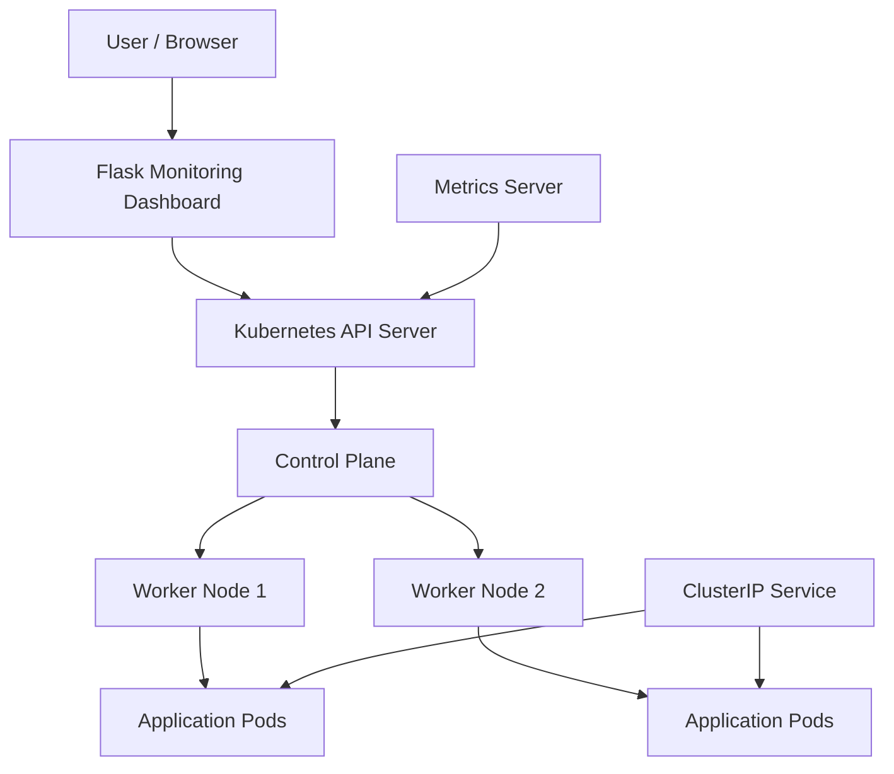

## Project Structure

```text
kubernetes-project/
│
├── app/
│   ├── app.py
│   ├── Dockerfile
│   ├── requirements.txt
│   ├── templates/
│   │   └── index.html
│   └── static/
│       ├── css/
│       │   └── dashboard.css
│       └── js/
│           ├── dashboard.js
│           └── chart.umd.min.js
│
├── backup/
├── screenshots/
├── deployment.yaml
├── kind-config.yaml
├── rbac.yaml
├── service.yaml
└── README.md
```

---

# Installation and Command Guide

All commands below are intended to be executed from Windows Command Prompt or PowerShell unless a different environment is specified.

## 1. Verify Prerequisites

```cmd
docker --version
```
Displays the installed Docker version.

```cmd
kubectl version --client
```
Displays the installed Kubernetes command-line client version.

```cmd
kind version
```
Displays the installed Kind version.

```cmd
docker info
```
Displays Docker Engine information and confirms that the Docker daemon is accessible.

```cmd
docker ps
```
Lists currently running Docker containers.

## 2. Navigate to the Project

```cmd
D:
```
Switches to the D: drive.

```cmd
cd \kubernetes-project
```
Navigates to the project directory.

```cmd
dir
```
Lists the project files and folders.

## 3. Create the Kind Kubernetes Cluster

```cmd
kind create cluster --name workload-cluster --config kind-config.yaml
```
Creates a Kubernetes cluster containing one control plane and two worker nodes using the Kind configuration file.

```cmd
kubectl cluster-info
```
Displays the Kubernetes control plane and cluster service addresses.

```cmd
kubectl get nodes
```
Lists all cluster nodes and their readiness status.

```cmd
kubectl get nodes -o wide
```
Displays additional node information, including IP addresses and node versions.

```cmd
docker ps
```
Verifies that the three Kind node containers are running.

## 4. Build the Flask Docker Image

```cmd
cd app
```
Moves into the application directory containing the Dockerfile.

```cmd
docker build -t workload-app:v1 .
```
Builds the Flask application Docker image and tags it as `workload-app:v1`.

```cmd
docker images
```
Lists locally available Docker images.

```cmd
cd ..
```
Returns to the main project directory.

## 5. Load the Image into Kind

```cmd
kind load docker-image workload-app:v1 --name workload-cluster
```
Loads the locally built application image into the Kind cluster nodes.

## 6. Apply Kubernetes Configuration Files

```cmd
kubectl apply -f rbac.yaml
```
Creates the ServiceAccount, ClusterRole and ClusterRoleBinding required for dashboard access to Kubernetes resources.

```cmd
kubectl apply -f service.yaml
```
Creates the ClusterIP Service that exposes the application internally on port 5000.

```cmd
kubectl apply -f deployment.yaml
```
Creates or updates the application Deployment according to its YAML configuration.

```cmd
kubectl get deployments
```
Displays Deployment replica counts and availability.

```cmd
kubectl get services
```
Lists Kubernetes Services and their assigned network addresses.

```cmd
kubectl get pods
```
Lists application Pods and their current status.

```cmd
kubectl get pods -o wide
```
Displays Pod status, IP address and the worker node on which each Pod is scheduled.

```cmd
kubectl describe deployment workload-deployment
```
Displays detailed Deployment configuration, replica information and related events.

```cmd
kubectl describe service workload-service
```
Displays the Service configuration, selector, ports and endpoints.

## 7. Install and Verify Metrics Server

Metrics Server is required to retrieve CPU and memory usage through Kubernetes resource metrics.

```cmd
kubectl apply -f https://github.com/kubernetes-sigs/metrics-server/releases/latest/download/components.yaml
```
Installs Metrics Server using its official Kubernetes deployment manifest.

For this local Kind environment, the kubelet TLS verification workaround was applied:

```cmd
kubectl patch deployment metrics-server -n kube-system --type=json -p "[{\"op\":\"add\",\"path\":\"/spec/template/spec/containers/0/args/-\",\"value\":\"--kubelet-insecure-tls\"}]"
```
Adds the `--kubelet-insecure-tls` argument to handle the local Kind kubelet certificate issue. This workaround is intended for an isolated learning environment, not production.

```cmd
kubectl rollout status deployment/metrics-server -n kube-system --timeout=120s
```
Waits for the Metrics Server Deployment to become ready.

```cmd
kubectl get pods -n kube-system
```
Checks the status of system Pods, including Metrics Server.

```cmd
kubectl top nodes
```
Displays CPU and memory utilization for Kubernetes nodes.

```cmd
kubectl top pods
```
Displays CPU and memory utilization for application Pods.

## 8. Access the Monitoring Dashboard

```cmd
kubectl port-forward svc/workload-service 5000:5000
```
Forwards local port 5000 to the Kubernetes Service so the dashboard can be accessed through a browser.

Open the dashboard:

**http://localhost:5000/dashboard**

Other application endpoints:

| Endpoint | Description |
|---|---|
| `/` | Returns application information in JSON |
| `/health` | Checks application health |
| `/dashboard` | Opens the monitoring dashboard |
| `/api/*` | Provides dashboard monitoring data |

Test the application from another terminal:

```cmd
curl http://localhost:5000/
```
Sends a request to the application root endpoint.

```cmd
curl http://localhost:5000/health
```
Checks whether the application health endpoint responds successfully.

## 9. Monitor the Kubernetes Cluster

```cmd
kubectl get nodes -w
```
Continuously watches node readiness changes.

```cmd
kubectl get pods -w
```
Continuously watches Pod creation, scheduling and status changes.

```cmd
kubectl get pods -o wide -w
```
Continuously monitors Pod status and node placement.

```cmd
kubectl get events --sort-by=.lastTimestamp
```
Displays Kubernetes events ordered by their latest timestamp to help investigate scheduling and node-related changes.

```cmd
kubectl top nodes
```
Checks current node resource utilization.

```cmd
kubectl top pods
```
Checks current application Pod resource utilization.

---

# Experiments Performed

## Experiment 1: Initial Workload Distribution

The Deployment was initially configured with six replicas.

```cmd
kubectl get deployments
```
Verifies that the Deployment has six desired and available replicas.

```cmd
kubectl get pods -o wide
```
Identifies the worker node on which each application Pod is running.

**Observed distribution:**

| Node | Application Pods |
|---|---:|
| Control Plane | 0 |
| Worker 1 | 3 |
| Worker 2 | 3 |
| Total | 6 |

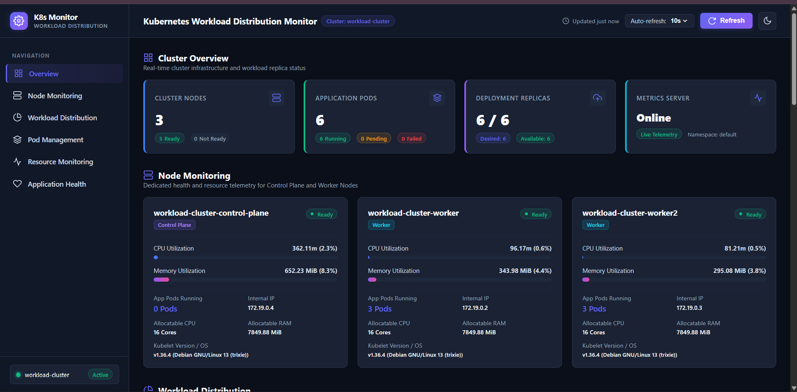

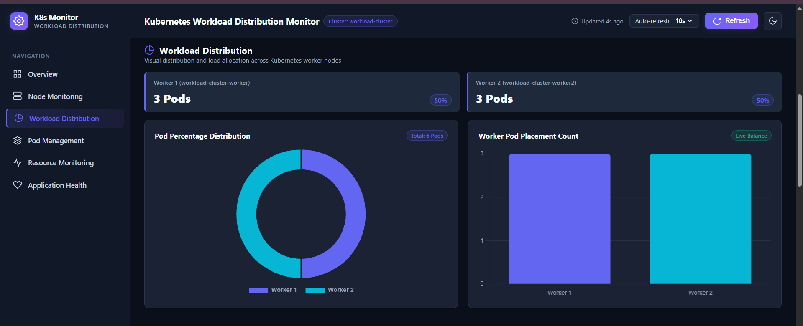

## Experiment 2: Node Failure and Recovery

**Objective:** Observe how Kubernetes responds when a worker node becomes unavailable.

### Step 1: Check initial node status

```cmd
kubectl get nodes
```
Verifies that all cluster nodes are initially Ready.

### Step 2: Stop Worker 2

```cmd
docker stop workload-cluster-worker2
```
Stops the Docker container representing Worker 2 to simulate a node failure.

### Step 3: Observe node failure

```cmd
kubectl get nodes
```
Checks whether Kubernetes detects the failed worker and marks it NotReady.

### Step 4: Monitor Pod rescheduling

```cmd
kubectl get pods -o wide -w
```
Watches old Pods terminate and replacement Pods get scheduled on available worker nodes.

### Step 5: Inspect Kubernetes events

```cmd
kubectl get events --sort-by=.lastTimestamp
```
Displays events related to node unavailability, Pod eviction and scheduling.

### Step 6: Verify application health during failure

```cmd
curl http://localhost:5000/health
```
Tests whether the application responds through the forwarded Service endpoint while Worker 2 is unavailable.

### Step 7: Restore Worker 2

```cmd
docker start workload-cluster-worker2
```
Restarts the Docker container representing Worker 2.

### Step 8: Verify node recovery

```cmd
kubectl get nodes -w
```
Waits until Worker 2 returns to Ready state.

**Observation:**

- Worker 2 became NotReady.
- Its existing Pods were eventually terminated.
- Kubernetes created replacement Pods on Worker 1.
- The Deployment maintained six available replicas after rescheduling.
- Worker 2 recovered successfully after restarting.
- Existing Pods were not automatically moved back to Worker 2.

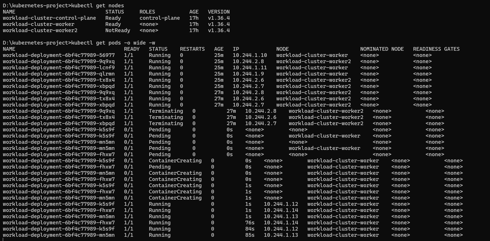

## Experiment 3: Horizontal Scaling

**Objective:** Increase the number of application replicas and observe how Kubernetes schedules the additional Pods.

### Step 1: Check the current replica count

```cmd
kubectl get deployments
```
Verifies that the Deployment currently has six available replicas.

### Step 2: Scale the Deployment to eight replicas

```cmd
kubectl scale deployment workload-deployment --replicas=8
```
Increases the desired number of application Pods from six to eight.

### Step 3: Verify the Deployment

```cmd
kubectl get deployments
```
Checks whether all eight desired replicas have become available.

### Step 4: Inspect Pod placement

```cmd
kubectl get pods -o wide
```
Displays the eight Pods and identifies their assigned worker nodes.

### Step 5: Monitor resource usage

```cmd
kubectl top nodes
```
Measures node CPU and memory consumption after scaling.

```cmd
kubectl top pods
```
Measures CPU and memory consumption for each application Pod.

**Observed distribution:**

| Node | Application Pods |
|---|---:|
| Worker 1 | 6 |
| Worker 2 | 2 |
| Total | 8 |

All eight application Pods reached the Running and Ready state.

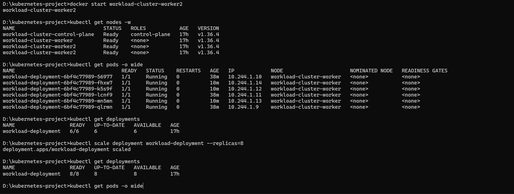

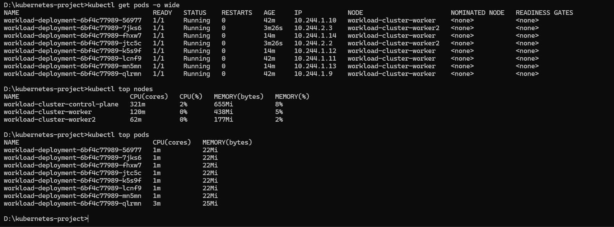

## Experiment 4: Dashboard Verification

The dashboard was refreshed after scaling to verify that the live cluster state was reflected correctly.

**Final observed dashboard values:**

- Total nodes: 3
- Ready nodes: 3
- Application Pods: 8
- Running Pods: 8
- Available replicas: 8/8
- Worker 1: 6 Pods
- Worker 2: 2 Pods
- Metrics Server: Online

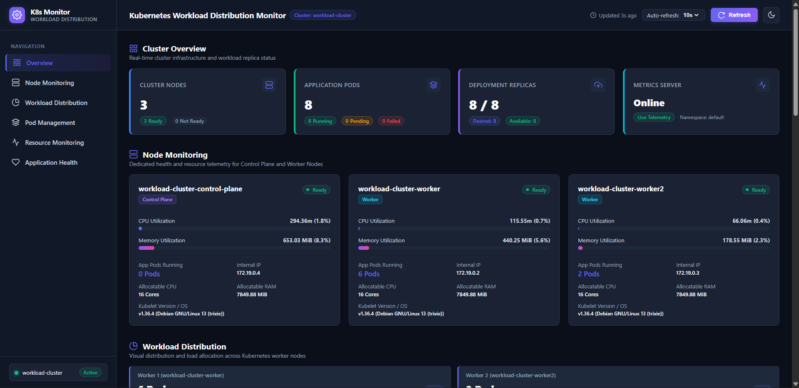

---

# Dashboard Features

### 1. Cluster Overview

Displays total nodes, node readiness, running Pods, replica availability and Metrics Server status.

### 2. Node Monitoring

Displays node health, CPU utilization, memory utilization, allocatable resources and scheduled Pod counts.

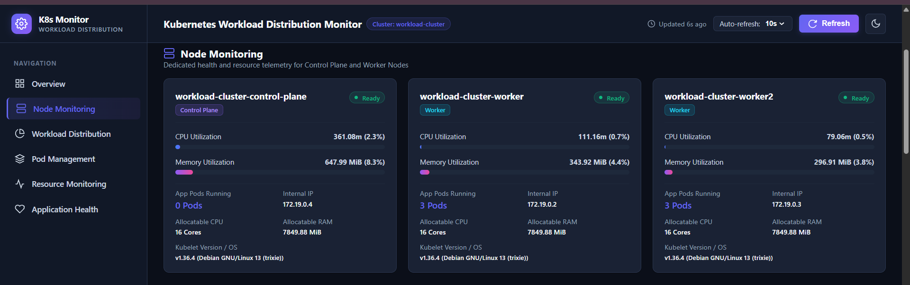

### 3. Workload Distribution

Displays Pod placement across worker nodes using doughnut and bar charts.

### 4. Pod Management

Displays Pod names, readiness, IP addresses, assigned nodes, restart counts, CPU and memory usage.

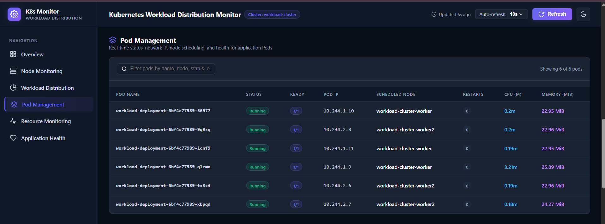

### 5. Resource Monitoring

Displays node-level and Pod-level CPU and memory utilization.

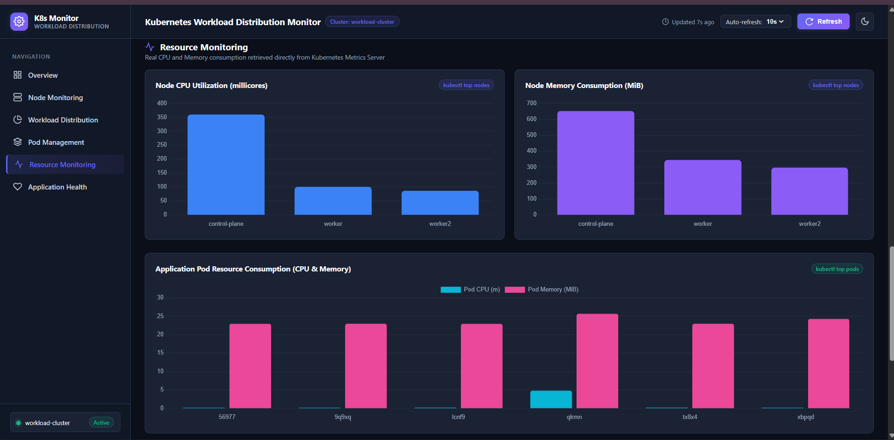

### 6. Application Health and Load Testing

Tests application health and sends multiple requests to observe which Pods handle them.

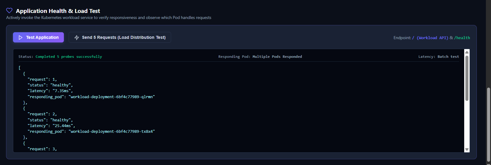

---

# Experiment Summary

| Experiment | Total Pods | Worker 1 | Worker 2 |
|---|---:|---:|---:|
| Initial deployment | 6 | 3 | 3 |
| Worker 2 failure | 6 | 6 | 0 |
| Worker 2 recovery | 6 | 6 | 0 |
| Horizontal scaling | 8 | 6 | 2 |

**Key observations:**

- Kubernetes schedules Pods across available worker nodes.
- Deployment maintains the desired replica count.
- Failed-node workloads can be recreated on healthy nodes when sufficient capacity exists.
- Existing Pods are not automatically rebalanced when a failed node recovers.
- Horizontal scaling increases the desired number of application replicas.
- Metrics Server provides CPU and memory utilization data.

# Conclusion

The project successfully demonstrates Kubernetes workload distribution in a multi-node cluster.

The experiments verified multi-replica deployment, Pod scheduling, resource monitoring, application health, node failure recovery and horizontal scaling.

The custom monitoring dashboard provides a visual interface to understand cluster status, workload placement and resource utilization.

This project demonstrates the fundamental capabilities of Kubernetes for container orchestration, workload management and application availability.

# Team Members

| Sl. No. | Name | Registration Number |
|---:|---|---|
| 1 | Ishani G | 01FE22BCI009 |
| 2 | Chaitra V | 01FE25BCI706 |
| 3 | Sagar P M | 01FE25BCI712 |
| 4 | Abhijit R H | 01FE25BCI709 |

# References

- [Kubernetes Documentation](https://kubernetes.io/docs/)
- [Kind Documentation](https://kind.sigs.k8s.io/)
- [Docker Documentation](https://docs.docker.com/)
- [Metrics Server](https://github.com/kubernetes-sigs/metrics-server)
- [Flask Documentation](https://flask.palletsprojects.com/)

---

**Project:** Kubernetes Cluster Workload Distribution

**Environment:** Docker Desktop, Kind and Kubernetes

**Application:** Flask-based Workload Monitoring Dashboard
